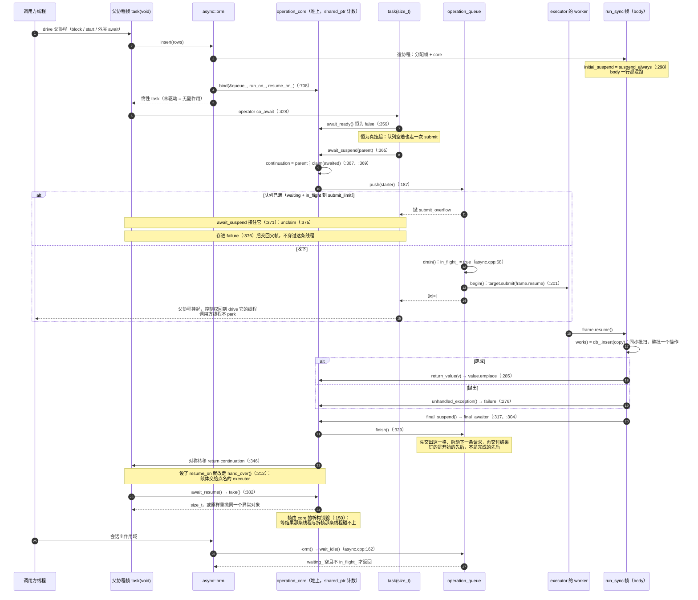
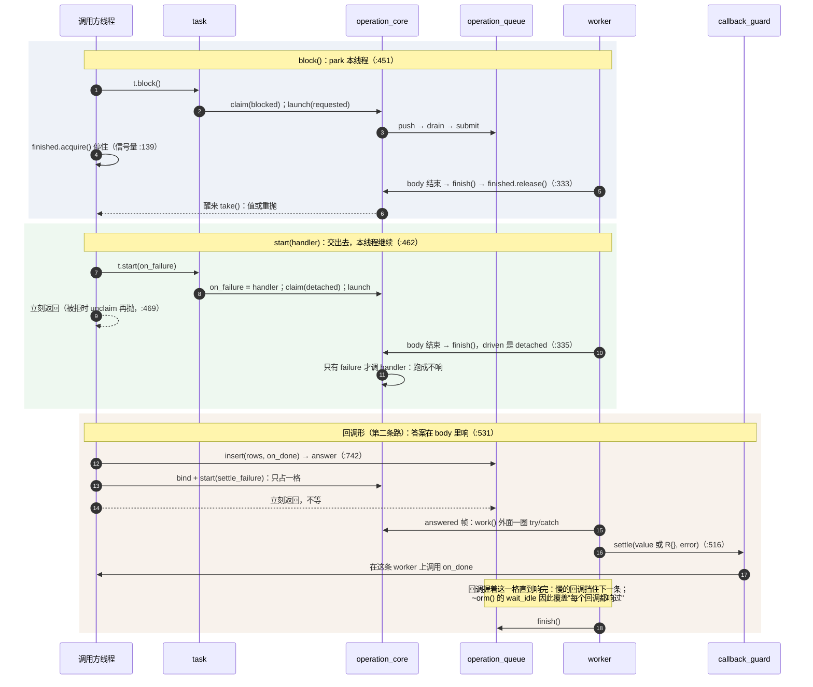

# 异步表面的时序图

`async.hpp`（design.md §4.11）里那几个协程相关类型——`task<T>`、
`detail::operation_core<T>`、`task_awaiter<T>`、`operation_queue`、`executor`、
`callback_guard<R>`——在两条路上各自怎么搭手。不带文件名的行号都在
`include/uniorm/async.hpp`：那里只剩声明与模板。函数体——队列那五个成员、会话与
句柄、`executor` 的虚析构——都在 `src/async/async.cpp`，写作
`async.cpp:NNN`。

## 一、`co_await session.insert(rows)`（默认池，未设 run_on / resume_on）

## 二、三个 drive 动作与回调形，在同一格 FIFO 上的分工

## 三、类型分工与生命周期

- **`task<T>`（`:394`）**：装一个 `shared_ptr<operation_core<T>>`，加上三个
  drive 动作与 `co_await`。可移动不可复制；没驱动就丢掉等于无副作用。
- **`operation_core<T>`（`:135`）**：结果槽、`failure`、`finished` 那枚信号量、
  `continuation`、`on_failure`、`queue`、`run_on`、`resume_on`、`driven`。协程帧
  挂在它上面、由它的析构销毁（`:150`），所以它一定比 promise 活得久——promise
  里那个裸指针不能被析构读。
- **`task_promise<T>`（`:295`）**：`initial_suspend` 挂起与 `final_suspend` 的
  对称转移。它是帧的一部分，从不自毁。
- **`task_awaiter<T>`（`:356`）**：`await_ready` 恒 false，`await_suspend`
  里 claim 加 launch，被拒时就地折成这一次 await 的失败。它挂在父帧的
  挂起点上。
- **`operation_queue`（`:85`，函数体 `async.cpp:21-90`）**：每会话一条 FIFO——
  `waiting_`、`in_flight_`、`draining_`、`limit_`。会话按值持有它，`~orm()` 等它
  安静。
- **`executor`（`:36`）**：只有 `submit`，交出活就返回；它的虚析构在
  `async.cpp:17`。`run_on` 说阻塞那一段去哪儿，`resume_on` 说续体回到
  哪儿。
- **`callback_guard<R>` 与 `answered<R>`（`:510`、`:531`）**：第二条路的出口，
  `settle` 幂等。帧带着调用方的回调，响完才交格。

## 四、三个 drive 动作与回调形的差别，在这四点上看

- **`co_await`**（`:356`）：挂起的是父协程帧，不是线程。结果落在 `await_resume`
  （`:382`），失败在 `co_await` 那一点原样重抛。被 `submit_limit` 拒时
  `await_suspend`（`:365`）自己接住那一次抛出：先 `unclaim()`（`:375`），
  再把异常存进 `failure`（`:376`），交回的是父帧而不是穿过跑这一帧的那条
  线程——溢出因此成为这一次 await 自己的失败，从 body 的 `catch` 里出来，
  和驱动报的错走同一条路。这条路没有调用点可抛。task 虽然回到未驱动状态，
  `failure` 却不会再清掉，所以接住之后要重造一次请求，不能对着同一个具名
  task 再 `co_await`。
- **`block()`**（`:407`）：park 在这条线程的那枚二进制信号量上（`:139`）。结果走
  `take()`，失败从 `block()` 重抛。被拒时先 `unclaim()`（`:456`）再原样抛，task
  留在未驱动状态，过一会儿再 drive 是合法写法。
- **`start(handler)`**（`:419`）：调用方立刻返回，`T` 不交付。失败唯一的出口是
  `on_failure`，跑成的那次不响。被拒时同样 `unclaim()` 再抛（`:469`）。
- **回调形**（`:742`）：调用方立刻返回。结果交付给 `on_done` 的第一个参数，
  失败在第二个参数、此时第一个是 `R{}`。空的 `on_done` 同样抛在调用点，被拒的
  那次也抛在调用点且都不响——请求根本没进队列。

两条最容易踩的线：会话必须活过它交出去的操作（这条由库代守，`~orm()` 里那句
`wait_idle()`（`async.cpp:162`）；同样的等待也能显式取
`orm::wait_all_operations()`（`:623`），会话不散就把交出去的都等齐——它只等
**已受理**的那些，被 `submit_limit` 拒的那次不在里面）；配置面与 `sync()`
只属于没有在飞操作的时刻——它们改的正是这条队列要保护的那份状态，两边都不检查。
